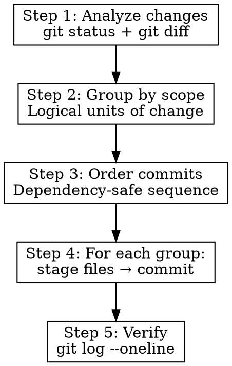

# Smart Commits

Analyze current changes, split into multiple well-scoped conventional commits, handle staging, and create commits directly. Brief subjects. Body only when "why" isn't obvious.

## When to Use

- Changes ready to commit
- User invokes `/smart-commits`
- Multiple logical changes mixed in working tree
- Want clean, well-scoped commit history

## When NOT to Use

- User wants to craft commit messages manually
- Interactive rebase in progress
- User explicitly asks for a single commit

## Flow



## Step 1: Analyze Changes

Run `git status` and `git diff` (staged + unstaged). Collect:
- All modified files
- All new/untracked files
- All deleted files
- What changed in each file (read diffs)

If nothing to commit → inform user and stop.

## Step 2: Group by Scope

Analyze changes and group into logical commits. Each group = one commit.

### Grouping Strategy

1. **By feature/domain:** Changes that implement one logical thing together
2. **By type:** Separate fixes from features from refactors from chores
3. **By scope:** Changes to same module/component/package together
4. **Dependencies first:** If commit B depends on commit A, A comes first

### When to Split

- Different files serve different purposes → split
- Same file has unrelated changes → commit with best-fit group (can't split within a file)
- Config change + feature code → split
- Test + implementation → can stay together if tightly coupled
- Rename/move + logic change → split

### When NOT to Split

- Changes are tightly coupled and meaningless apart
- Single file, single purpose change
- Splitting would create broken intermediate states

### If Splitting Not Possible

If changes are too intertwined to split cleanly → one well-scoped commit. Don't force artificial splits that create broken intermediate states.

## Step 3: Order Commits

Order groups so each commit leaves the codebase in a valid state:

1. Infrastructure/config changes first
2. Dependencies/package changes
3. Core logic/library changes
4. Feature/fix implementations
5. Tests
6. Documentation/cosmetic last

## Step 4: Create Commits

For each group, in order:

### 4a. Stage Files

```bash
git add <file1> <file2> ...
```

Stage only files belonging to current group. Use specific file paths, never `git add -A` or `git add .`.

**Cannot split within a single file** — `git add -p` requires interactive input which is not available. If a file has changes belonging to multiple logical groups, commit it with the best-fit group.

### 4b. Write Commit Message

**Format: Conventional Commits**

```
<type>(<scope>): <subject>

[optional body — only when why isn't obvious]
```

**Types:**
| Type | Use When |
|------|----------|
| `feat` | New feature or capability |
| `fix` | Bug fix |
| `refactor` | Code change that neither fixes nor adds |
| `chore` | Maintenance, deps, configs |
| `docs` | Documentation only |
| `style` | Formatting, whitespace, semicolons |
| `test` | Adding or fixing tests |
| `perf` | Performance improvement |
| `ci` | CI/CD changes |
| `build` | Build system or external deps |

**Scope:** Module, component, or area affected. Examples: `auth`, `api`, `db`, `ui`, `config`, `deps`.

**Subject rules:**
- Imperative mood ("add" not "added" or "adds")
- No period at end
- Lowercase first letter after colon
- ≤50 characters (hard limit for subject line)
- Describe WHAT, not HOW

**Body rules:**
- Only include when the "why" isn't obvious from the subject
- Wrap at 72 characters
- Explain motivation, not mechanics
- Skip for trivial/obvious changes

**Breaking changes:**
```
feat(api)!: change authentication endpoint

BREAKING CHANGE: /auth/login now requires email instead of username
```

### 4c. Commit

```bash
git commit -m "$(cat <<'EOF'
<type>(<scope>): <subject>

<optional body>
EOF
)"
```

Do not add model attribution: no `Co-Authored-By:`, no `Signed-off-by:` naming a model, and no other line that credits Claude, Anthropic or an AI. The user forbids it, and this rule overrides Claude Code's default commit instructions, which add a `Co-Authored-By` trailer.

The commit message holds the header, an optional body and, for a breaking change, the `BREAKING CHANGE:` line. Add no other trailers.

### 4d. Repeat

Move to next group. Stage its files. Commit. Repeat until all groups committed.

## Step 5: Verify

After all commits created:

```bash
git log --oneline -n <number_of_commits_created>
```

Present result to user. Show what was committed and in what order.

## Examples

### Input: Mixed changes across auth and API

```
modified:   src/auth/login.ts        (bug fix)
modified:   src/api/users.ts         (new endpoint)
modified:   src/api/users.test.ts    (test for new endpoint)
modified:   package.json             (new dependency)
new file:   src/api/types.ts         (types for new endpoint)
```

### Output: 3 commits

```
chore(deps): add zod validation library
fix(auth): handle expired token redirect
feat(api): add user profile endpoint
```

### Input: Single focused change

```
modified:   src/utils/format.ts
modified:   src/utils/format.test.ts
```

### Output: 1 commit

```
fix(utils): correct date formatting for UTC offset
```

## Edge Cases

| Situation | Action |
|-----------|--------|
| Only staged changes exist | Commit staged only, don't touch unstaged |
| Mix of staged + unstaged | Analyze ALL, but warn user about mixed state |
| Merge conflict markers in files | Stop. Inform user to resolve conflicts first |
| Empty diff (whitespace only) | `style` type if intentional, skip if accidental |
| Huge changeset (20+ files) | Still group logically, may result in more commits |
| `.env` or credentials in changes | WARN user. Do not commit secrets. |

## Common Mistakes

| Mistake | Fix |
|---------|-----|
| Adding a model-attribution trailer | Do not add it (see 4c) |
| `git add .` or `git add -A` | Always stage specific files by path |
| Subject > 50 chars | Shorten. Move detail to body. |
| Past tense ("added feature") | Imperative ("add feature") |
| Body explaining what code does | Body explains WHY, not WHAT |
| Forcing splits that break state | One commit better than broken intermediate |
| Committing secrets | Warn user, skip those files |
| Period at end of subject | No period |
| Capital after colon | Lowercase: `feat(x): add` not `feat(x): Add` |
